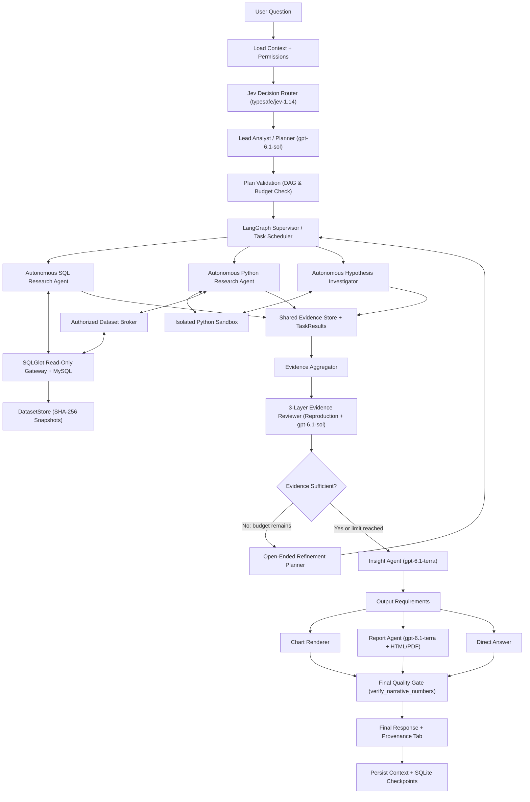

# Multi-Agent AI Data Analyst — Hierarchical Autonomous Research System


-059669)


A production-oriented **Multi-Agent AI Data Analyst** built on **LangGraph**, **OpenRouter Jev Decisions API (`typesafe/jev-1.14`)**, **OpenAI Responses API (`gpt-6-luna`, `gpt-6.1-sol`, `gpt-6.1-terra`)**, **FastAPI**, **MySQL 8.0 (`classicmodels`)**, an **Isolated Python Subprocess Sandbox**, and **React + Plotly**.


> **Quick Links for Reviewers & Recruiters:**
> - **Sample Exported Executive PDF Report:** [`docs/examples/november-2004-revenue-rca-report.pdf`](docs/examples/november-2004-revenue-rca-report.pdf)
> - **Sample Exported Standalone HTML Report:** [`docs/examples/november-2004-revenue-rca-report.html`](docs/examples/november-2004-revenue-rca-report.html)
> - **25-Case Quantitative Evaluation Benchmark:** [`evals/run_benchmark.py`](evals/run_benchmark.py) ([`evals/latest_results.json`](evals/latest_results.json))
> - **Deep Architecture & Security Docs:** [`docs/ARCHITECTURE.md`](docs/ARCHITECTURE.md) · [`docs/SECURITY_AND_LIMITS.md`](docs/SECURITY_AND_LIMITS.md)

---

## Why This System Stands Out

Instead of restricting agents to predefined SQL templates or fixed Python functions—or trusting unverified LLM prose—this system executes **bounded autonomous research loops** (`Understand → Plan → Act → Observe → Reflect → Continue / Finish`) with **3-layer epistemic verification**:

1. **Lead Analyst / Planning Agent (`gpt-6.1-sol`)** designs a dependency-aware `AnalysisPlan` DAG (`sql`, `python`, `hypothesis` tasks) with open-ended analytical objectives or structured checks.
2. **Deterministic Plan Validator (`app/orchestration/validator.py`)** verifies DAG acyclicity (DFS cycle detection + priority Kahn topological sort), table permissions, tool modes, SHA-256 task fingerprints, and budget caps.
3. **LangGraph Supervisor** fans out independent tasks concurrently via `Send` across:
   - **Autonomous SQL Research Agent (`SQLAnalyst.investigate_sql`)**: Inspects unfamiliar schemas, authors custom `SELECT` queries (CTEs, window functions, JOINs), observes query results, and self-repairs SQL errors inside `ReadOnlyGateway` (SQLGlot MySQL AST parser).
   - **Autonomous Python Research Agent (`PythonAnalysisAgent.investigate`)**: Dynamically writes Python code (`pandas`, `numpy`, `scipy`, `scikit-learn`, `statsmodels`, `polars`, `plotly`, `matplotlib`), executes it in `IsolatedProcessSandboxProvider` (static AST gate + secret-scrubbed environment + `sys.addaudithook`), debugs tracebacks, and requests extra datasets via `AuthorizedDatasetBroker`.
   - **Autonomous Hypothesis Investigator (`HypothesisAgent.investigate_hypotheses`)**: Formulates testable hypotheses, runs statistical tests inside the Python sandbox, and marks contradicted hypotheses as `rejected` or `revised`.
4. **3-Layer Independent Verification (`EvidenceReviewerAgent`)** verifies completeness, checks accounting bridge reconciliation ($0.00 discrepancy check), and **independently re-executes** saved Python code in a fresh sandbox workspace against immutable SHA-256 `DatasetStore` snapshots before triggering bounded refinement if needed.
5. **Insight & Report Generation Agents (`gpt-6.1-terra`)** synthesize narratives audited by `verify_narrative_numbers()` (blocking hallucinated figures), interactive Plotly charts, a dedicated **`Methodology, Code & Audit Trace`** UI provenance tab, and downloadable **HTML / PDF** executive reports.

---

## 1. Orchestration Architecture



---

## 2. Quantitative Evaluation & Guardrail Benchmark (`25 / 25` — `100%`)

Reproduce the full 25-case evaluation benchmark suite locally in under 12 seconds:

```powershell
.\.venv\Scripts\python.exe evals/run_benchmark.py
```

| Benchmark Category | Cases | Pass Rate | Mean Latency | What Is Verified |
| :--- | :---: | :---: | :---: | :--- |
| **1. SQL & `ReadOnlyGateway` AST** | `5 / 5` | **100.0%** | `~18 ms` | Top-N aggregations, multi-table JOINs, CTEs, dynamic FK catalog inspection, and autonomous SQL error self-repair (`SQL-01`..`SQL-05`). |
| **2. DAG Validation & Variance Bridges** | `5 / 5` | **100.0%** | `~12 ms` | Kahn topological sort, DFS cycle rejection, SHA-256 task fingerprint deduplication, and zero-residual price-volume decomposition (`DAG-01`..`DAG-05`). |
| **3. Autonomous Python Sandbox Research** | `5 / 5` | **100.0%** | `~420 ms` | `scikit-learn` RFM `KMeans(k=3)` + silhouette score, `scipy.stats` OLS regression, Lorenz Gini/Pareto concentration, and runtime `KeyError` self-repair (`PY-01`..`PY-05`). |
| **4. 3-Layer Verification & Grounding** | `5 / 5` | **100.0%** | `~310 ms` | Independent code re-execution on SHA-256 dataset snapshots, tampered metric mismatch detection, and hallucinated currency figure interception (`VER-01`..`VER-05`). |
| **5. Adversarial & Security Guardrails** | `5 / 5` | **100.0%** | `~240 ms` | 100% block rate on SQL mutations (`DROP`, `DELETE`, `SELECT *`, `SLEEP`, `;`, `--`), Python AST escapes (`socket`, `subprocess`, `eval`, `__subclasses__`), secret scrubbing, and `sys.addaudithook` `.env` read attempts (`SEC-01`..`SEC-05`). |

---

## 3. UI Provenance Tab & Zero-Setup Demo Showcases

The React + Plotly frontend (`frontend/src/App.tsx`) includes:
- **Zero-Setup Interactive Demo Showcases:** Reviewers can replay two complete multi-agent runs (*November 2004 vs. October 2004 Root-Cause DAG* and *Autonomous RFM KMeans Python Sandbox*) directly in the UI—even before configuring live API keys.
- **3-Tab Executive Workspace:**
  1. **Insights, Charts & Briefing:** KPI grid, executive synthesis flow diagram, interactive Plotly bar/trend charts, verified findings, hypothesis impact bars, and recommendations.
  2. **Data Tables:** Formatted financial tables with variance color-coding and one-click CSV download.
  3. **Methodology, Code & Audit Trace:** Displays the 3-Layer Verification verdict, LangGraph Task DAG cards, generated Python sandbox code with **`SHA-256 Sandbox Reproduced`** badges, executed read-only SQL queries, multi-model token/latency/cost telemetry, and the chronological trace timeline.

---

## 4. Smart Model Selection & Configuration

All model assignments and runtime budgets are configurable in `.env` (see [`.env.example`](.env.example)):

| Analytical Role | Default Model | Reasoning Effort | Agent / Module |
|---|---|---|---|
| **Decision Routing** | `typesafe/jev-1.14` | `decision_choice` | `OpenRouterJevRouter` (`app/agents/router.py`) |
| **Lead Analyst & Planning** | `gpt-6.1-sol` | `medium` | `PlannerAgent` (`app/agents/planner.py`) |
| **Autonomous Python Research** | `gpt-6.1-sol` | `medium` | `PythonAnalysisAgent` (`app/agents/python_analyst.py`) |
| **Autonomous SQL Research** | `gpt-6.1-sol` | `medium` | `SQLAnalyst.investigate_sql` (`app/agents/sql_analyst.py`) |
| **Structured SQL Drafting** | `gpt-6-luna` | `low` | `SQLAnalyst.draft_for_task` (`app/agents/sql_analyst.py`) |
| **Hypothesis Investigation** | `gpt-6.1-sol` | `medium` | `HypothesisAgent` (`app/agents/hypothesis.py`) |
| **Evidence Review & Audit** | `gpt-6.1-sol` | `medium` | `EvidenceReviewerAgent` (`app/agents/evidence_reviewer.py`) |
| **Business Insights & Reports** | `gpt-6.1-terra` | `medium` / `low` | `ReporterAgent`, `ReportGenerationAgent` |

---

## 5. Quick Start (Local Development)

### 1. Configure Environment

```powershell
Copy-Item .env.example .env
# Configure DATABASE_URL, OPENAI_API_KEY, and OPENROUTER_API_KEY in .env
```

### 2. Start Backend (FastAPI + LangGraph)

```powershell
cd C:\Projects\multi-agent-data-analyst
.\.venv\Scripts\Activate.ps1
uvicorn app.main:app --app-dir backend --reload --host 127.0.0.1 --port 8000
```

- **API Health Check:** `http://127.0.0.1:8000/health`
- **Swagger OpenAPI UI:** `http://127.0.0.1:8000/docs`
- **SSE Live Progress Endpoint:** `POST http://127.0.0.1:8000/api/v1/questions/stream`
- **HTML / PDF Report Exports:** `GET /api/v1/runs/{run_id}/report.html` and `GET /api/v1/runs/{run_id}/report.pdf`

### 3. Start Frontend (React + Vite + Plotly)

```powershell
cd C:\Projects\multi-agent-data-analyst\frontend
npm run dev
```

- **Web Application:** `http://127.0.0.1:5173` (Includes zero-setup **Instant Interactive Demo Showcases** + live query streaming)

---

## 6. Run Test & Evaluation Suites

```powershell
cd C:\Projects\multi-agent-data-analyst

# 1. Run 25-Case Quantitative Evaluation & Security Guardrail Benchmark
.\.venv\Scripts\python.exe evals/run_benchmark.py

# 2. Offline Unit, Sandbox Security & Orchestration Pytest Suite
.\.venv\Scripts\python.exe -m pytest backend/tests -k "not live" -v

# 3. Live End-to-End Verification (Read-Only MySQL + OpenRouter Jev + OpenAI)
.\.venv\Scripts\python.exe -m pytest backend/tests/test_database.py backend/tests/test_providers.py backend/tests/test_live_smoke.py backend/tests/test_autonomous_agents.py -k "live" -v
```
