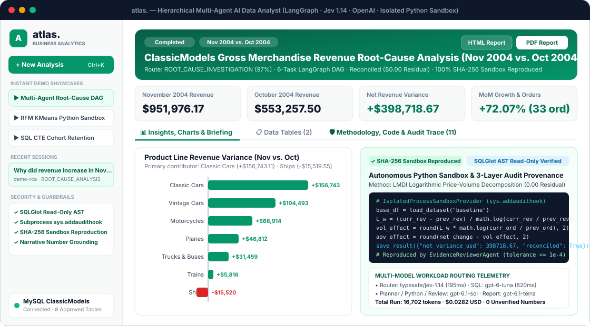
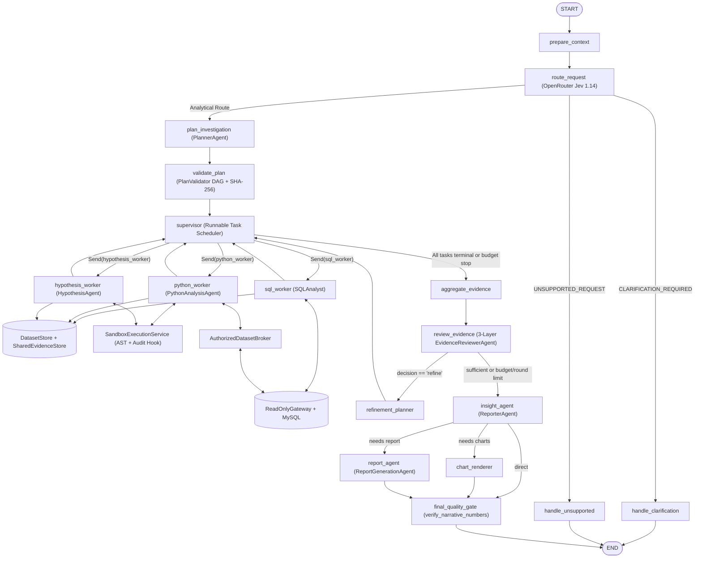

# Multi-Agent AI Data Analyst — Hierarchical Autonomous Research System


-059669)


A production-oriented **Multi-Agent AI Data Analyst** built on **LangGraph**, **OpenRouter Jev Decisions API (`typesafe/jev-1.14`)**, **OpenAI Responses API (`gpt-6-luna`, `gpt-6.1-sol`, `gpt-6.1-terra`)**, **FastAPI**, **MySQL 8.0 (`classicmodels`)**, an **Isolated Python Subprocess Sandbox**, and **React 19 + Plotly**.



> **Quick Links:**
> - **Sample Exported Executive PDF Report:** [`docs/examples/november-2004-revenue-rca-report.pdf`](docs/examples/november-2004-revenue-rca-report.pdf)
> - **Sample Exported Standalone HTML Report:** [`docs/examples/november-2004-revenue-rca-report.html`](docs/examples/november-2004-revenue-rca-report.html)
> - **25-Case Quantitative Evaluation Benchmark:** [`evals/run_benchmark.py`](evals/run_benchmark.py) ([`evals/latest_results.json`](evals/latest_results.json))
> - **Architecture & Security Docs:** [`docs/ARCHITECTURE.md`](docs/ARCHITECTURE.md) · [`docs/SECURITY_AND_LIMITS.md`](docs/SECURITY_AND_LIMITS.md)

---

## 1. System Overview & Core Capabilities

Instead of restricting agents to hardcoded SQL templates or trusting unverified LLM prose, the system executes **bounded autonomous research loops** (`run_bounded_agent_loop` in `app/agents/runtime.py`) orchestrated by a **17-node LangGraph Supervisor-Worker DAG** (`app/orchestration/workflow.py`) with **3-layer epistemic verification**:

1. **Intent Resolution & Probabilistic Routing**:
   - `prepare_context` extracts canonical metrics, comparison periods, dimensions, and table permissions (`app/services/semantics.py` & `app/services/schema_catalog.py`).
   - `route_request` invokes `OpenRouterJevRouter` (`typesafe/jev-1.14`, with deterministic keyword fallback) to classify requests into 9 route types (`SIMPLE_SQL`, `COMPARISON_ANALYSIS`, `ROOT_CAUSE_ANALYSIS`, `HYPOTHESIS_TESTING`, `FORECASTING`, `SEGMENTATION`, `OPEN_ENDED_RESEARCH`, `CLARIFICATION_REQUIRED`, `UNSUPPORTED_REQUEST`).
2. **Dependency-Aware DAG Planning & Validation**:
   - `PlannerAgent` (`gpt-6.1-sol`) authors an `AnalysisPlan` containing `sql`, `python`, and `hypothesis` tasks with explicit dependencies, expected output schemas, and execution modes (`structured`, `open_ended`, `autonomous_Loop`).
   - `PlanValidator` (`app/orchestration/validator.py`) validates DAG acyclicity via DFS cycle detection, computes priority Kahn topological sort order, enforces table permissions, assigns deterministic SHA-256 task fingerprints, and sets query/token/time budgets.
3. **Concurrent Supervisor-Worker Execution (`Send` Fan-Out)**:
   - `supervisor` dispatches all runnable tasks whose dependencies are `COMPLETED` (up to `MAX_PARALLEL_TASKS`), deduplicating identical SHA-256 fingerprints within a run and blocking downstream nodes (`BLOCKED`) if an upstream dependency fails.
   - **SQL Worker (`SQLAnalyst`)**: Supports both deterministic SQL compilation (`app/services/sql_builder.py`) and multi-step autonomous SQL exploration (`investigate_sql`), inspecting schema relationships (`inspect_schema`, `get_sample_rows`) and self-repairing SQL errors through `ReadOnlyGateway` (SQLGlot MySQL AST validation).
   - **Python Worker (`PythonAnalysisAgent`)**: Supports both structured analytical tools (`app/services/analysis_tools.py`: variance bridges, Pareto concentration, anomaly Z-scores, linear forecasts) and multi-step autonomous Python research (`investigate`) inside `SandboxExecutionService` (`pandas`, `numpy`, `scipy`, `scikit-learn`, `statsmodels`, `polars`, `plotly`, `matplotlib`), plus on-demand dataset pulls via `AuthorizedDatasetBroker`.
   - **Hypothesis Worker (`HypothesisAgent`)**: Generates falsifiable hypotheses (`rank_and_design`), tests them against SQL evidence or autonomous Python sandbox experiments (`investigate_hypotheses`), and evaluates statistical proof (`evaluate`, `evaluate_with_llm`).
4. **3-Layer Epistemic Verification & Targeted Refinement**:
   - `EvidenceReviewerAgent` (`app/agents/evidence_reviewer.py`) performs:
     1. **Completeness & Coverage Check**: Verifies required KPIs, variance breakdowns, and task completion statuses.
     2. **Accounting & Reconciliation Check**: Validates zero-residual variance bridges (`price_effect + volume_effect == delta`) and numeric consistency across tasks.
     3. **Independent Code Re-Execution**: Re-runs saved Python code artifacts in a fresh sandbox workspace against immutable SHA-256 `DatasetStore` snapshots and compares recomputed metrics within `1e-4` relative tolerance.
   - If evidence is insufficient and budget remains (`refinement_round < max_plan_refinements`), `refinement_planner` appends targeted follow-up tasks (`plan_refinement` / `plan_open_ended_refinement`) and loops back to `supervisor`.
5. **Grounded Synthesis, Chart Rendering & Executive Report Export**:
   - `insight_agent` (`ReporterAgent`) synthesizes findings, tables, and recommendations.
   - ` output_router` fans out to `chart_renderer` (Plotly figures) and `report_agent` (`ReportGenerationAgent` with standalone HTML & PDF exports).
   - `final_quality_gate` runs `verify_narrative_numbers()` to cross-check every currency and percentage claim in the narrative against computed evidence and tables, stripping unverified figures before persisting the final report and SQLite checkpoints.

---

## 2. LangGraph Orchestration Flow



---

## 3. Codebase Structure

The codebase is organized for clarity, minimal boilerplate, and strict separation of concerns:

```text
multi-agent-data-analyst/
├── .env.example                        # Environment template
├── backend/
│   ├── requirements.txt                # Python dependencies
│   ├── app/
│   │   ├── config.py                   # Simple frozen Settings dataclass loaded via python-dotenv
│   │   ├── exceptions.py               # Structured AppError hierarchy & FastAPI exception handlers
│   │   ├── main.py                     # FastAPI entry point, REST & SSE endpoints, HTML/PDF exports
│   │   ├── schemas.py                  # Pydantic API request/response models
│   │   ├── orchestration/
│   │   │   ├── contracts.py            # Task, Plan, Budget, Hypothesis, Evidence & Review schemas
│   │   │   ├── state.py                # LangGraph AnalysisState TypedDict & state reducers
│   │   │   ├── validator.py            # DAG cycle detection, Kahn sort & SHA-256 task fingerprinting
│   │   │   └── workflow.py             # 17-node AnalyticalWorkflow LangGraph state machine
│   │   ├── agents/
│   │   │   ├── runtime.py              # Bounded autonomous loop runner (run_bounded_agent_loop)
│   │   │   ├── router.py               # OpenRouter Jev Decisions router + heuristic fallback
│   │   │   ├── planner.py              # Lead Analyst initial & refinement DAG planner
│   │   │   ├── sql_analyst.py          # Compiled SQL builder + autonomous SQL exploration loop
│   │   │   ├── python_analyst.py       # Sandbox Python research loop + deterministic tool runner
│   │   │   ├── hypothesis.py           # Hypothesis design, autonomous sandbox testing & evaluation
│   │   │   ├── evidence_reviewer.py    # 3-layer verification + independent code reproduction
│   │   │   ├── reporter.py             # Narrative synthesis, Plotly chart builder & number auditor
│   │   │   └── report_agent.py         # Executive brief compiler + standalone HTML & PDF renderer
│   │   └── services/
│   │       ├── db.py                   # ReadOnlyGateway (SQLGlot AST guard + MySQL connection pool)
│   │       ├── schema_catalog.py       # MySQL schema introspection, FK join graph & column hints
│   │       ├── semantics.py            # Canonical business metrics, dimensions & date range resolver
│   │       ├── sql_builder.py          # Deterministic SQL compiler for standard analytical queries
│   │       ├── analysis_tools.py       # Deterministic Python tools (bridge, Pareto, Z-score, forecast)
│   │       ├── sandbox.py              # Static AST validator + isolated subprocess with sys.addaudithook
│   │       ├── dataset_store.py        # SQLite immutable dataset snapshot store with SHA-256 hashes
│   │       ├── evidence_store.py       # SQLite shared evidence & dataset metadata store
│   │       ├── dataset_broker.py       # Authorized read-only SQL broker for sandbox agents
│   │       ├── models.py               # OpenAI Responses API client & workload model selector
│   │       ├── store.py                # SQLite session history & run persistence store
│   │       └── telemetry.py            # Run cancellation registry, trace spans & token cost calculator
│   └── tests/                          # Unit, integration, security, autonomous & orchestration tests
├── frontend/
│   └── src/
│       ├── App.tsx                     # 3-tab React + Plotly workspace, SSE client & provenance viewer
│       ├── api.ts                      # REST & SSE API client helpers
│       ├── demoRuns.ts                 # 3 zero-setup interactive multi-agent demo runs
│       ├── types.ts                    # TypeScript interfaces matching backend Pydantic schemas
│       └── styles.css                  # Responsive executive dashboard stylesheet
└── evals/
    ├── run_benchmark.py                # 25-case quantitative evaluation & security benchmark runner
    └── latest_results.json             # Latest benchmark execution report
```

---

## 4. Security Guardrails & Epistemic Controls

| Layer | Component | Enforcement Mechanism |
| :--- | :--- | :--- |
| **SQL AST Gate** | `ReadOnlyGateway` (`app/services/db.py`) | Parses every query with `sqlglot` (`dialect="mysql"`). Blocks multi-statement SQL, comments (`--`, `/*`), `SELECT *`, mutations (`INSERT`, `UPDATE`, `DELETE`, `DROP`, `ALTER`, `TRUNCATE`, `GRANT`), file access (`INTO OUTFILE`, `LOAD_FILE`), blocking functions (`SLEEP`, `BENCHMARK`, `GET_LOCK`), system schemas (`information_schema`, `mysql`, `performance_schema`, `sys`), and unapproved tables. Injects `MAX_RESULT_ROWS` (`LIMIT`) automatically. |
| **Python Static AST Gate** | `validate_python_code_ast` (`app/services/sandbox.py`) | Parses generated code with `ast.parse()`. Allows only approved scientific libraries (`math`, `statistics`, `json`, `collections`, `itertools`, `functools`, `datetime`, `re`, `decimal`, `fractions`, `random`, `typing`, `numpy`, `pandas`, `scipy`, `statsmodels`, `sklearn`, `polars`, `matplotlib`, `plotly`). Blocks `os`, `sys`, `subprocess`, `socket`, `http`, `urllib`, `requests`, `pathlib`, `shutil`, `ctypes`, `importlib`, `open`, `eval`, `exec`, `compile`, `__import__`, and dunder introspection (`__subclasses__`, `__globals__`, `__builtins__`, `__code__`, etc.). |
| **Runtime Process Sandbox** | `IsolatedProcessSandboxProvider` (`app/services/sandbox.py`) | Runs code in an isolated temporary directory with a secret-scrubbed environment (`OPENAI_API_KEY`, `DATABASE_URL`, etc. removed), enforces wall-clock timeout (`SANDBOX_TIMEOUT_SECONDS`) and output size limits (`SANDBOX_MAX_OUTPUT_BYTES`), and installs a kernel-level `sys.addaudithook` inside the child process that blocks network sockets, process spawning, and file writes/reads outside the ephemeral workspace. |
| **Immutable Data Lineage** | `DatasetStore` (`app/services/dataset_store.py`) | Materializes every SQL result and Python-derived dataset with a canonical SHA-256 content hash so downstream agents and `EvidenceReviewerAgent` verify calculations on identical snapshots. |
| **Hallucination Gate** | `verify_narrative_numbers` (`app/agents/reporter.py`) | Extracts currency (`$X,XXX`) and percentage (`X.X%`) claims from generated narratives and verifies each against ground-truth numbers in SQL tables, evidence records, and variance bridges (allowing 1.5% rounding tolerance). Unverified claims are stripped or flagged. |

---

## 5. Model Routing & Workload Configuration

Configuration is managed in [`backend/app/config.py`](backend/app/config.py) via a single frozen `Settings` dataclass loaded from `.env` (see [`.env.example`](.env.example)):

| Workload Role | Environment Variable | Default Model | Effort | Module |
| :--- | :--- | :--- | :---: | :--- |
| **Decision Router** | `OPENROUTER_JEV_MODEL` | `typesafe/jev-1.14` | `decision` | `app/agents/router.py` |
| **Lead Analyst & Planner** | `OPENAI_PLANNER_MODEL` | `gpt-6.1-sol` | `medium` | `app/agents/planner.py` |
| **Complex Root-Cause (RCA)** | `OPENAI_RCA_MODEL` | `gpt-6.1-sol` | `high` | `app/agents/planner.py` |
| **Autonomous SQL Research** | `OPENAI_SQL_RESEARCH_MODEL` | `gpt-6.1-sol` | `medium` | `app/agents/sql_analyst.py` |
| **Compiled SQL Drafting** | `OPENAI_SQL_MODEL` | `gpt-6-luna` | `low` | `app/agents/sql_analyst.py` |
| **Autonomous Python Research** | `OPENAI_PYTHON_MODEL` | `gpt-6.1-sol` | `medium` | `app/agents/python_analyst.py` |
| **Hypothesis Investigation** | `OPENAI_HYPOTHESIS_MODEL` | `gpt-6.1-sol` | `medium` | `app/agents/hypothesis.py` |
| **3-Layer Evidence Review** | `OPENAI_REVIEW_MODEL` | `gpt-6.1-sol` | `medium` | `app/agents/evidence_reviewer.py` |
| **Business Insights Synthesis** | `OPENAI_INSIGHT_MODEL` | `gpt-6.1-terra` | `medium` | `app/agents/reporter.py` |
| **Executive Report Writer** | `OPENAI_REPORT_MODEL` | `gpt-6.1-terra` | `low` | `app/agents/report_agent.py` |
| **Schema & Tool Selection** | `OPENAI_SCHEMA_MODEL` / `OPENAI_TOOL_SELECTION_MODEL` | `gpt-6-luna` | `low` | `app/services/models.py` |

---

## 6. REST & Streaming API Endpoints (`backend/app/main.py`)

When `API_TOKEN` is set in `.env`, pass `X-API-Token: <token>` in request headers.

| Method | Path | Description |
| :---: | :--- | :--- |
| `GET` | `/health` | Returns service status, database connectivity, and configured model mappings. |
| `GET` | `/api/v1/catalog` | Returns approved business metrics, dimensions, date bounds, and live MySQL table schemas. |
| `POST` | `/api/v1/sessions` | Creates a new multi-turn conversation session. |
| `GET` | `/api/v1/sessions` | Lists recent conversation sessions. |
| `GET` | `/api/v1/sessions/{session_id}` | Retrieves session context and conversation history. |
| `GET` | `/api/v1/sessions/{session_id}/runs` | Lists all analytical runs for a session. |
| `POST` | `/api/v1/questions` | Executes a synchronous full multi-agent analytical run and returns `ChatResponse`. |
| `POST` | `/api/v1/questions/stream` | Streams real-time Server-Sent Events (`progress`, `complete`, `error`) as each LangGraph node and agent step executes; automatically cancels the run if the client disconnects. |
| `POST` | `/api/v1/runs/{run_id}/cancel` | Cooperatively cancels an in-progress run across worker threads and agent loops. |
| `GET` | `/api/v1/runs/{run_id}` | Fetches a persisted run record and full report payload. |
| `GET` | `/api/v1/runs/{run_id}/report.html` | Renders a standalone, print-ready executive HTML report for a run. |
| `GET` | `/api/v1/runs/{run_id}/report.pdf` | Generates and downloads a formatted multi-page PDF executive report (`atlas-report-<id>.pdf`). |

---

## 7. Quantitative Evaluation & Guardrail Benchmark (`25 / 25` — `100%`)

Reproduce the 25-case benchmark suite locally in under 12 seconds:

```powershell
.\.venv\Scripts\python.exe evals/run_benchmark.py
```

| Category | Cases | Pass Rate | What Is Verified |
| :--- | :---: | :---: | :--- |
| **1. SQL & `ReadOnlyGateway` AST** | `5 / 5` | **100%** | Top-N aggregations, multi-table JOINs, CTEs, dynamic FK catalog inspection, and autonomous SQL error self-repair (`SQL-01`..`SQL-05`). |
| **2. DAG Validation & Variance Bridges** | `5 / 5` | **100%** | Kahn topological sort, DFS cycle rejection, SHA-256 task fingerprint deduplication, and zero-residual price-volume decomposition (`DAG-01`..`DAG-05`). |
| **3. Autonomous Python Sandbox Research** | `5 / 5` | **100%** | `scikit-learn` RFM `KMeans(k=3)` + silhouette score, `scipy.stats` OLS regression, Lorenz Gini/Pareto concentration, and runtime `KeyError` self-repair (`PY-01`..`PY-05`). |
| **4. 3-Layer Verification & Grounding** | `5 / 5` | **100%** | Independent code re-execution on SHA-256 dataset snapshots, tampered metric mismatch detection, and hallucinated currency figure interception (`VER-01`..`VER-05`). |
| **5. Adversarial & Security Guardrails** | `5 / 5` | **100%** | 100% block rate on SQL mutations (`DROP`, `DELETE`, `SELECT *`, `SLEEP`, `;`, `--`), Python AST escapes (`socket`, `subprocess`, `eval`, `__subclasses__`), secret scrubbing, and `sys.addaudithook` `.env` read attempts (`SEC-01`..`SEC-05`). |

---

## 8. Quick Start (Local Development)

### 1. Configure Environment

```powershell
Copy-Item .env.example .env
# Edit .env with your DATABASE_URL, OPENAI_API_KEY, and OPENROUTER_API_KEY
```

### 2. Start Backend (FastAPI + LangGraph)

```powershell
cd C:\Projects\multi-agent-data-analyst
.\.venv\Scripts\Activate.ps1
uvicorn app.main:app --app-dir backend --reload --host 127.0.0.1 --port 8000
```

- **Health Check:** `http://127.0.0.1:8000/health`
- **Interactive OpenAPI Docs:** `http://127.0.0.1:8000/docs`

### 3. Start Frontend (React 19 + Vite + Plotly)

```powershell
cd C:\Projects\multi-agent-data-analyst\frontend
npm install
npm run dev
```

- **Dashboard URL:** `http://127.0.0.1:5173`
- Includes **3 zero-setup interactive demo showcases** (*Nov 2004 vs. Oct 2004 Root-Cause DAG*, *Autonomous RFM KMeans Python Sandbox*, and *Autonomous SQL CTE Cohort Retention*), live SSE streaming progress, CSV table downloads, HTML/PDF report exports, and the **Methodology, Code & Audit Trace** provenance tab.

---

## 9. Running Tests

```powershell
cd C:\Projects\multi-agent-data-analyst

# 1. Run 25-Case Quantitative Evaluation & Security Benchmark
.\.venv\Scripts\python.exe evals/run_benchmark.py

# 2. Run Offline Unit, Integration, Sandbox, Autonomous Agents & Orchestration Suite
.\.venv\Scripts\pytest.exe backend/tests -k "not live" -v

# 3. Run Live Provider & Database Smoke Tests (requires live MySQL + API keys in .env)
.\.venv\Scripts\pytest.exe backend/tests/test_database.py backend/tests/test_providers.py backend/tests/test_live_smoke.py backend/tests/test_autonomous_agents.py -k "live" -v

# 4. Verify Frontend TypeScript & Production Bundle Build
npm --prefix frontend run build
```
