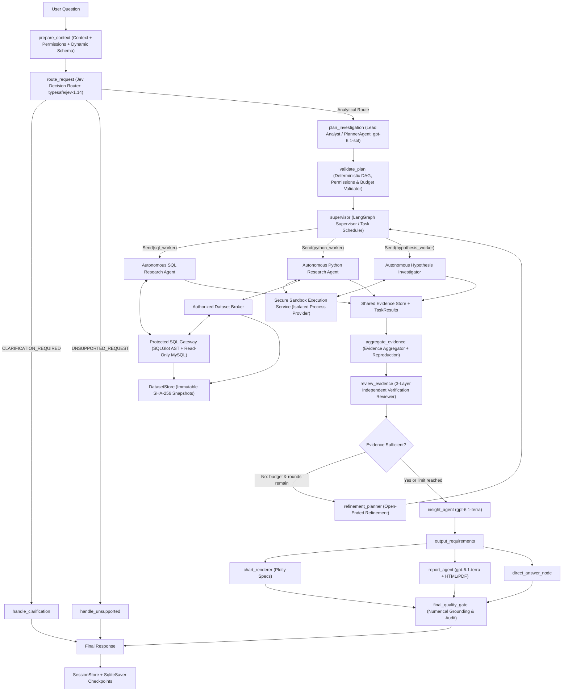

# Architecture and Engineering Choices

## 1. Hierarchical Autonomous Research Architecture

The system implements a **Hierarchical Autonomous Research Architecture** on **LangGraph**, **OpenRouter Jev (`typesafe/jev-1.14`)**, **OpenAI Responses API (`gpt-6-luna`, `gpt-6.1-sol`, `gpt-6.1-terra`)**, **MySQL 8.0 (`classicmodels`)**, and **React + Plotly**.

Agents execute bounded goal-driven research loops (**Understand → Plan → Act → Observe → Reflect → Continue / Finish**) backed by a **Sandbox Execution Service**, **Authorized Dataset Broker**, **Shared Evidence Store**, and **3-Layer Independent Verification**.

## 2. Core Components and Agent Runtime

| Component | Module | Model / Mechanism | Responsibility |
|---|---|---|---|
| **Autonomous Agent Runtime** | `app/agents/runtime.py` | `AutonomousAgentLoop` & `AgentLoopBudget` | Enforces bounded `Understand -> Plan -> Act -> Observe -> Reflect -> Finish` execution loops with compact history, repair tracking, cancellation checks, and OpenTelemetry spans. |
| **Jev Decision Router** | `app/agents/router.py` | OpenRouter `typesafe/jev-1.14` | Bounded entry-point decision routing and complexity hints. Invoked once per request. |
| **Lead Analyst / Planner** | `app/agents/planner.py` | OpenAI `gpt-6.1-sol` (`medium`) | Produces open-ended or structured `PlanDraft` task DAGs supporting autonomous SQL/Python objectives and open-ended refinement tasks. |
| **Plan Validator** | `app/orchestration/validator.py` | Deterministic Python | Validates task IDs, dependencies, DFS cycle freedom, table permissions, Python modes (`autonomous_research`, `custom_python`, `auto`, utility tools), fingerprints, and budget caps. |
| **LangGraph Supervisor** | `app/orchestration/workflow.py` | LangGraph Node + `Send` | Schedules ready tasks concurrently across SQL, Python, and Hypothesis workers, enforces budgets, and merges dynamic hypothesis/refinement tasks. |
| **Autonomous SQL Research Agent** | `app/agents/sql_analyst.py` | OpenAI `gpt-6.1-sol` / `gpt-6-luna` | `investigate_sql()` explores unfamiliar schemas via `SchemaCatalog.inspect_table_details`, writes custom `SELECT` queries (CTEs, window functions, JOINs), inspects results, and self-repairs SQL errors. Structured queries continue to use deterministic templates / single-shot synthesis. |
| **Autonomous Python Research Agent** | `app/agents/python_analyst.py` | OpenAI `gpt-6.1-sol` (`medium`) + Sandbox | `investigate()` profiles staged datasets, chooses analytical methods (`pandas`, `numpy`, `scipy`, `scikit-learn`, `statsmodels`, `polars`, `plotly`, `matplotlib`), writes dynamic code, observes outputs/errors, repairs broken code, and requests extra datasets via `AuthorizedDatasetBroker`. Retains the 10 deterministic tools (`app/services/analysis_tools.py`) as optional utilities. |
| **Sandbox Execution Service** | `app/services/sandbox.py` | Provider Interface (`IsolatedProcessSandboxProvider` / `ExternalSandboxProviderStub`) | Executes generated Python in isolated workspaces outside the FastAPI process with AST checks, sanitized environment variables, `sys.addaudithook` restrictions, timeouts, and artifact collection. Never falls back to unsafe host `exec()`. |
| **Authorized Dataset Broker** | `app/services/dataset_broker.py` | Gateway + Catalog + `DatasetStore` | Allows autonomous agents to inspect authorized schemas/profiles and fetch new read-only SQL snapshots into `DatasetStore` under budget and allowlist controls. |
| **Read-Only Gateway & Dataset Store** | `app/services/db.py`, `app/services/dataset_store.py` | SQLGlot MySQL AST + SQLite WAL | Enforces read-only `SELECT` constraints and stores immutable datasets keyed by SHA-256 content hashes. |
| **Shared Evidence Store** | `app/services/evidence_store.py` | SQLite WAL | Persists intermediate agent observations, methodology notes, and hypothesis updates linked by `run_id` and `task_id`. |
| **Hypothesis Investigation Agent** | `app/agents/hypothesis.py` | OpenAI `gpt-6.1-sol` (`medium`) + Sandbox | `investigate_hypotheses()` runs statistical tests in the Python sandbox and updates hypotheses as `supported`, `not_supported`, `rejected`, `revised`, or `inconclusive` while enforcing `causal_disclaimer`. |
| **3-Layer Verification Agent** | `app/agents/evidence_reviewer.py` | Execution + `reproduce_finding()` + `gpt-6.1-sol` | Re-runs saved Python code against immutable `DatasetStore` snapshots to verify summary numbers match (`reproduced` vs `mismatch`), checks accounting bridges, and requests `recalculate` or open-ended refinements when needed. |
| **Insight & Report Agents** | `app/agents/reporter.py`, `app/agents/report_agent.py` | OpenAI `gpt-6.1-terra` + `fpdf2` | Synthesizes evidence-backed narratives verified against allowed figures (`verify_narrative_numbers`), Plotly charts, HTML/PDF exports, and Python provenance metadata surfaced in the React UI. |

## 3. Data and State Contracts (`app/orchestration/contracts.py`)

- `QuerySpec` & `PythonToolSpec`: Support both structured queries/utilities and open-ended `mode="autonomous"` / `"custom"` objectives with `analysis_methods`, `custom_request`, and `custom_tables`.
- `TaskResult`: Captures full autonomous research provenance (`generated_code`, `methodology`, `execution_steps`, `artifacts`, `assumptions_checked`, `verification_status`, `repair_attempts`, `fingerprint`).
- `HypothesisRecord`: Tracks `status` (`untested`, `supported`, `not_supported`, `rejected`, `revised`, `inconclusive`), `measured_effect`, `share_of_change`, `p_value`, `statistical_evidence`, `revised_statement`, `evidence_ids`, and `causal_disclaimer`.
- `EvidenceReview` & `RefinementRequest`: Track deterministic issues (including reproduction mismatches), AI audit verdicts, and targeted refinement requests (`recalculate`, `drill_down`, `statistical_test`, `new_hypothesis`, `resolve_contradiction`, `additional_breakdown`).
